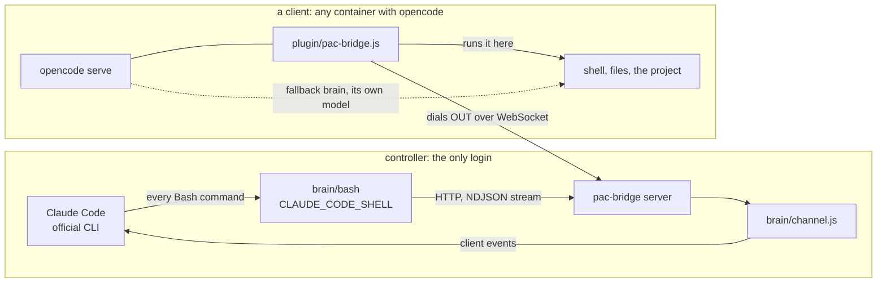

# pac-bridge

> **Next architecture:** HAPI, named PACs and multiple harness adapters are planned in [ARCHITECTURE.md](ARCHITECTURE.md). An incomplete OpenCode development launcher is described in [OPENCODE-EXPERIMENT.md](OPENCODE-EXPERIMENT.md). The existing implementation described below is the legacy shared-filesystem design and does not yet satisfy [the new acceptance criteria](ACCEPTANCE.md).

**Brains here, hands there.** One controller holds the only login and runs the official Claude
Code. Any number of containers, on this machine or behind a NAT anywhere, lend it their hands
through an opencode plugin. The same opencode is the fallback brain, so the brain becomes a
parameter instead of a container.

Built for a set of autonomous characters that live in games, chats and projects of their own,
and running them in production.

---

## Why this exists

**One login, in one place.** Every project that hosts its own Claude container needs its own
login, and logins inside containers expire on their own. We measured it the hard way: two agents,
each with a login of its own, woke about 3000 times each into `OAuth session expired` before
anyone noticed, and it was the second time in a month. A brain raised from the controller keeps no
copy of a login, so there is nothing left to expire.

**Projects receive brains instead of hosting them.** A project keeps its hands: its files, its
shell, its game client, its bot. It does not keep a Claude installation, and it never
authenticates anything.

**The brain is swappable.** Claude Code on a subscription, or opencode with any model an API key
reaches. The hands, the instructions and the files are the same, so switching is one word.

## The shape



1. **The client dials out.** The plugin opens a WebSocket to the bridge and keeps it, with
   reconnects. A client needs no open port and the controller never needs its address.
2. **Claude keeps its own tools.** Nothing is re-implemented as an MCP tool. Claude Code starts
   with `CLAUDE_CODE_SHELL` pointing at `brain/bash`, and only the place a command runs changes.
   That is why background commands, their completion notices, stopping them, subagents and hooks
   all work without a line of code written for any of them.
3. **The login never leaves the controller.** Claude Code is used the ordinary way. A client holds
   a bridge token and nothing else.
4. **The fallback brain is already on the client.** It is the same opencode, running its own model,
   driven through the bridge's relay to its HTTP API.

## The one trick, and what Claude Code actually does with a custom shell

Claude Code accepts a replacement shell for its Bash tool when the path contains `bash` or `zsh`.
Logged on Claude Code 2.1.251 with a wrapper that recorded its arguments, it calls that shell in
exactly three ways:

    bash -c env                          once, to read the environment
    bash -c -l <script>                  builds a snapshot of shell functions and options
    bash -c "source <snapshot> ... && eval '<cmd>' < /dev/null && pwd -P >| /tmp/claude-XXXX-cwd"

The last form is every command. Its tail writes the working directory into a LOCAL file that
Claude reads afterwards, which is how `cd` survives between calls. Run on the client, that file
lands on the client, so `brain/bash` asks for it back and writes it locally. Without that, every
`cd` is silently forgotten.

## Same paths, same masks: brain/run

The brain's file tools (Read, Write, Edit, Glob, Grep) run in the controller; only Bash is remote.
If the controller saw the project under a different path than the client, every path in the
project's own instructions would be wrong for half the tools. So `brain/run` starts Claude Code in
its own bwrap namespace with the client's tree bound at the client's OWN path. Nothing is
translated because nothing differs.

It also mirrors the client's masks. If the client's container overlays `.env` with a masked copy
and hides `.git`, the brain's view does the same, or the brain would read the very secrets its own
body is kept from. We verified it by hash: inside the sandbox `.env` matched the masked copy, not
the real file.

⛔ **`/tmp` is the one path the two sides do not share.** Anything both a command and a Read must
touch (a screenshot, a render, a draft) belongs in the working directory.

## What is verified

Each result below was produced by a real Claude Code session in the controller and checked from
outside that session, not taken from its own report.

| function | result |
|---|---|
| a command runs on the client: output, stderr, exit code | ✓ the client's hostname, exit 3 came back as 3 |
| `cd` persists between calls | ✓ including into a later background command |
| Read, Write, Edit, Glob, Grep | ✓ on the client's tree, at the client's paths |
| a background command, and the notice when it finishes | ✓ `task-notification: completed` arrived without polling |
| stopping a background command | ✓ `TaskStop`, and no process left on the client |
| killing the brain's shell kills the command on the client | ✓ SIGTERM gave 143 and the remote process was gone |
| subagents run their commands on the client too | ✓ the subagent's hostname was the client's |
| the client pokes a live session | ✓ `curl 127.0.0.1:4099/event` on the client woke an idle session at once |
| the fallback brain through the same bridge | ✓ opencode with DeepSeek called `bash hostname` on the client in 6 s |
| reconnection | ✓ the bridge was rebuilt and the clients were back in 3 s |
| a brain reaches only its own client | ✓ another client's commands and relay answered 503, as if it did not exist |
| production | ✓ two game-playing agents think this way full time |

## Quick start

**1. The bridge.** Node 22 and the dependencies in `package-lock.json`.

```sh
docker compose up -d --build                 # listens on 8790
node tokens.mjs add-client my-agent          # client token + a brain token scoped to it
```

`tokens.json` holds sha256 hashes only and is re-read on every check, so adding a client needs no
restart. Where tokens live is set in `bridge.env` and `.env` (see the `.example` files).

**2. The client.** Any container with opencode.

```yaml
volumes:
  - ./pac-bridge/plugin/pac-bridge.js:/path/to/project/.opencode/plugin/pac-bridge.js:ro
environment:
  PAC_BRIDGE_URL: ws://pac-bridge:8790/client
  PAC_CLIENT_NAME: my-agent
  PAC_CLIENT_TOKEN: ${MY_AGENT_TOKEN}
```

⛔ opencode loads plugins lazily, on the first request its server answers. Touch it once
(`curl localhost:4096/config`) or the plugin never connects. It writes `/tmp/pac-bridge.connected`
while the connection lives, so a starter can wait for it with `test -f`.

**3. A brain.** In the controller, where Claude Code is logged in.

```sh
PAC_CLIENT=my-agent PAC_ROOT=/srv/my-agent PAC_ROOT_AS=/repo PAC_CWD=/repo/agent \
PAC_RW="/repo/agent" PAC_MASK="/repo/.env=/repo/.env.masked" PAC_HIDE="/repo/.git" \
  brain/run -p "look around and report" --model sonnet --dangerously-skip-permissions
```

`brain/launch <window> <prompt-file>` raises the same brain as a live interactive session in tmux
and records its terminal as footage (`brain/record`). `examples/loop.py` shows how a project's own
wake loop swaps its local `claude -p` for this with one branch.

**4. Events.** Any program on the client may poke the brain:

```sh
curl -s -X POST 127.0.0.1:4099/event -d '{"text":"the build finished","meta":{"job":"42"}}'
```

Load `brain/channel.js` into a live session with
`--mcp-config` and `--dangerously-load-development-channels server:pac-bridge` (channels are a
research preview of Claude Code).

**5. The fallback brain.** The bridge relays the client's own opencode HTTP API as it is:

```sh
curl -H "Authorization: Bearer $BRAIN" -X POST http://pac-bridge:8790/opencode/my-agent/session
curl -H "Authorization: Bearer $BRAIN" -X POST http://pac-bridge:8790/opencode/my-agent/session/<id>/message \
  -d '{"model":{"providerID":"deepseek","modelID":"deepseek-chat"},"parts":[{"type":"text","text":"..."}]}'
```

## Security model, stated plainly

- **Brain tokens are scoped** to the clients they list. A client outside the scope answers exactly
  like one that is not connected, so a brain cannot learn which others exist.
- **The brain runs sandboxed** with the client's tree only, the client's masks, and the Claude
  login it needs to think. Reading the login file itself is denied by rule.
- ⛔ **The brain sees the client's whole environment.** Claude Code's first call is `bash -c env`,
  and it runs on the client. A client that must hide a variable from its brain starts
  `opencode serve` without it.
- **An event is a fact, never an order.** The first event we pushed into a live session said "run
  hostname and tell me". The session declined and called it a likely prompt injection, which is
  right. What a brain does with an event is decided by the task it was raised with.

## Traps we fell into, so you do not have to

- **A plugin that fails to import is dropped in silence.** One unterminated string, and opencode
  logged nothing while the plugin simply did not exist. Check first with the Bun that opencode's
  binary carries: `BUN_BE_BUN=1 opencode -e "import('./pac-bridge.js')"`.
- **`pkill -f "<pattern>"` inside `sh -c` kills its own shell**, whose command line holds the same
  pattern. Bracket one letter: `pkill -f '[o]pencode serve'`.
- **Swapping a path as a substring mangles output.** With `/repos/x=/repo`, every `/reports` in a
  command's output became `/repos/xrts`. Replace a path only whole, at a segment boundary. (Better
  still, bind the same path and translate nothing, which is what `brain/run` does.)
- **Channel events need a live session.** In `claude -p` the whole run is one turn, and an event
  that arrived during it never reached the model.
- **`setsid` forks when the caller already leads a process group**, and returns at once. A caller
  reading the brain's output reads nothing. `brain/run` relies on bwrap's own pid namespace and
  `--die-with-parent` instead.
- **A `Write(path)` deny rule is ignored by Claude Code**, which says so on every start. `Edit(path)`
  covers all file writes.

## Prior art, and what was taken

Nothing we found covers the whole case; several projects cover parts of it.

| project | what it does | what we took |
|---|---|---|
| ACP, the Agent Client Protocol | the standard for "the agent changes, the client supplies files and terminals" | the split of roles |
| torarnv/claude-remote-shell | replaces the shell of Claude Code's Bash and runs commands over SSH | the central trick, and that the cwd file must come back |
| mathematic-inc/claude-tools-mcp | Claude's tools re-implemented as an HTTP MCP server | the pattern for files on a client with no shared disk |
| opencode-mcp | Claude drives opencode's HTTP API | the pattern for driving the fallback brain |
| Claude Code channels | an MCP server pushes events into a running session | how the client pokes the brain |
| coder/agentapi | one HTTP API over many agents | the idea of a single door; the project is deprecated |

## A note on subscriptions

Anthropic allows a Claude subscription only through its own applications, and since early 2026 it
rejects subscription tokens from third-party harnesses. This design keeps to that: the brain is the
official Claude Code, used the ordinary way, and opencode is the body. The opposite direction,
making Claude the model inside opencode, is exactly what is not allowed.

## Layout

```
server.js, package.json, Dockerfile, compose.yml   the bridge
tokens.mjs                                         issue a client's tokens
plugin/pac-bridge.js                               the client half, an opencode plugin
brain/bash                                         CLAUDE_CODE_SHELL: runs each command on the client
brain/run                                          start a bridged brain, sandboxed, same paths
brain/launch, brain/record                         a live session by hand, and its footage
brain/channel.js                                   client events into a live session
client-up.sh                                       a client in an existing container, for testing
examples/loop.py                                   a project's wake loop using brain/run
```

Part of a larger design for autonomous characters, published as a template:
[persona-workplace-template](https://github.com/3ndetz/persona-workplace-template).

## License

MIT
